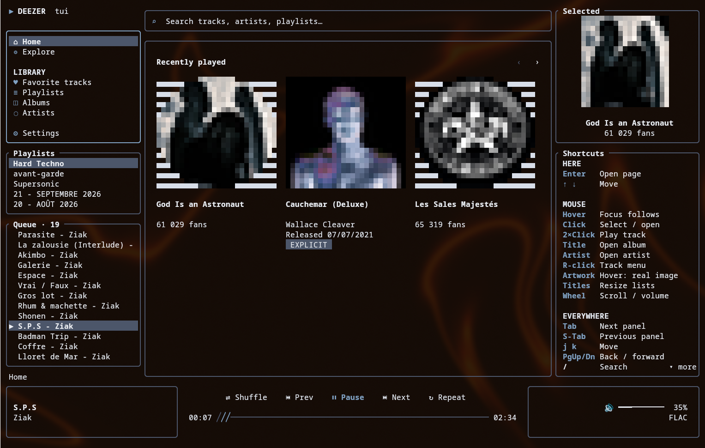
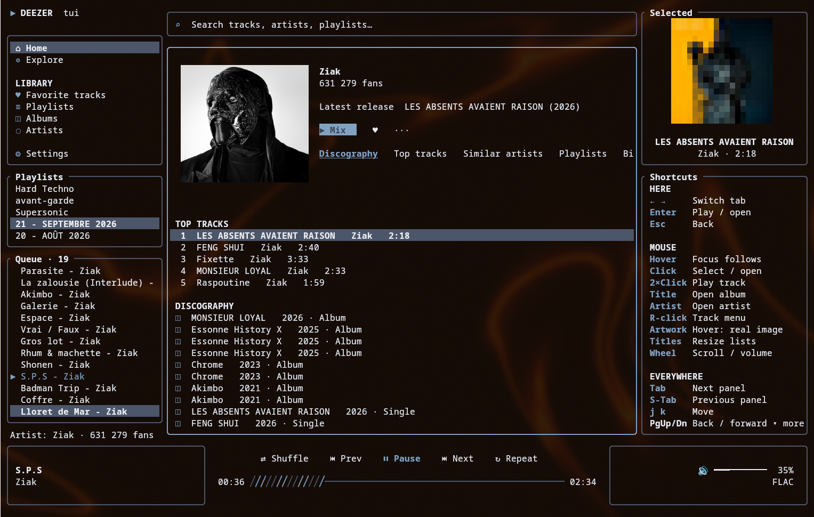
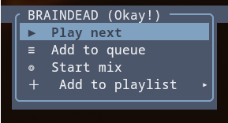
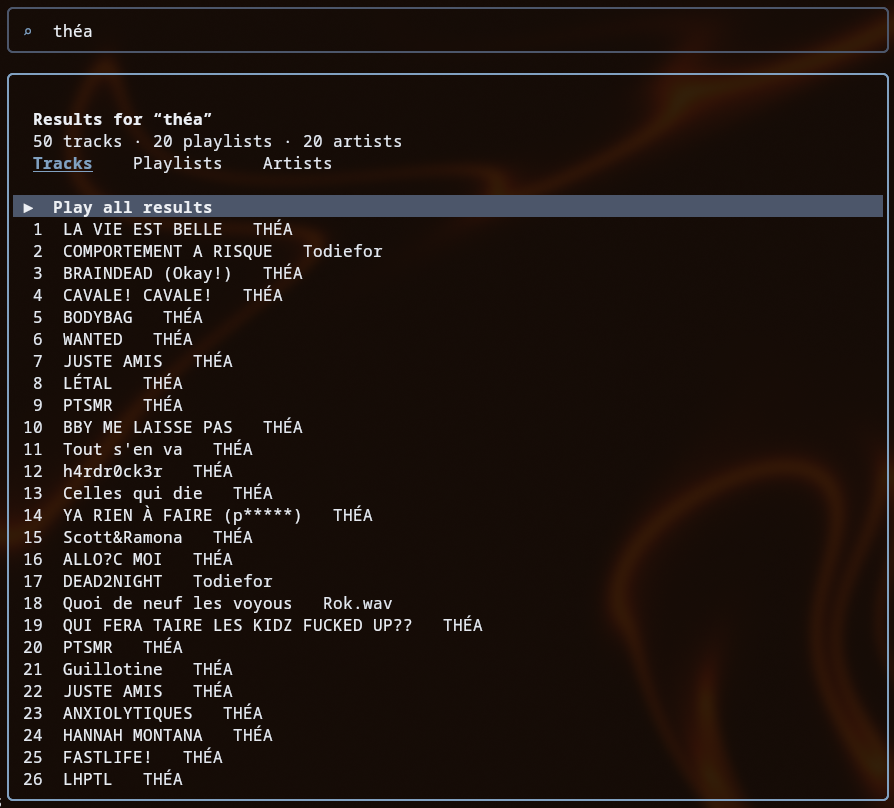
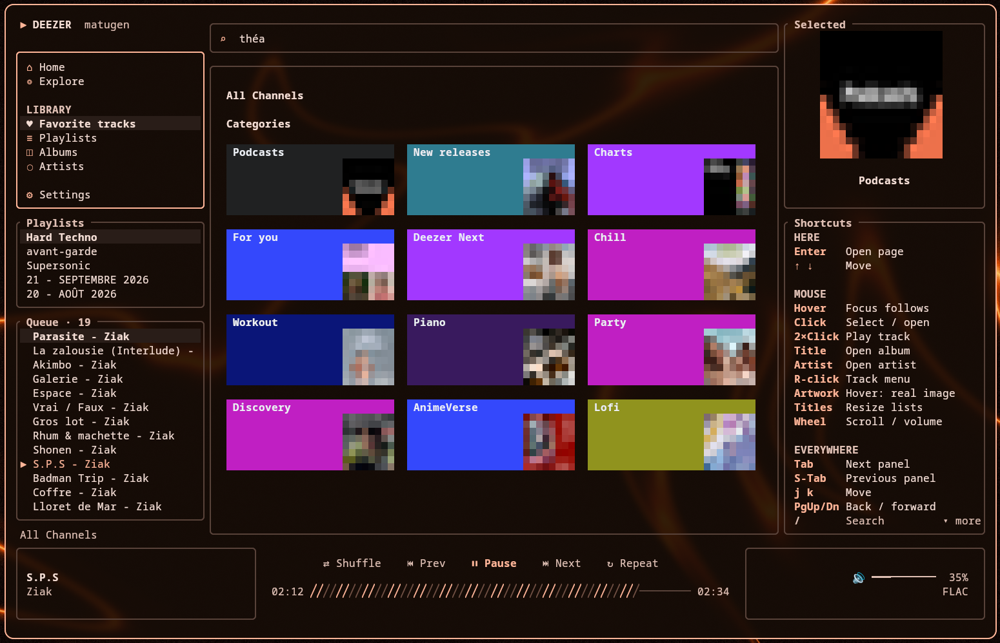

# deezer-tui

A Deezer client for the terminal, laid out like deezer.com: Home, Explore, your library, artist and album pages,
Flow and track mixes, with full mouse support and real cover art when the terminal can show images.

This is a fork of [Minuga-RC/deezer-tui](https://github.com/Minuga-RC/deezer-tui), which its author no longer plans to
maintain. It keeps the original engine (streaming, decryption, MPRIS, Discord) and reworks most of the interface.

> [!IMPORTANT]
> Like the original, this project is heavily "vibecoded" with AI.

## Screenshots

| | |
|---|---|
|  |  |
| Artist page: top tracks, albums, related artists | Track menu: play next, add to queue, add to a playlist, start a mix |
|  |  |
| Search by category: tracks, albums, artists, playlists | Matugen theme, following your wallpaper colours |


In terminals with the kitty graphics protocol (kitty, Ghostty, WezTerm…), hovering a cover shows the real image.
Elsewhere covers are drawn with Unicode half-blocks.

## Features

### Browsing
- **Home** and **Explore** laid out like deezer.com: sections, cover rows, genres, *See all*, Flow
- **Library** sidebar: favourite tracks, playlists, albums, artists
- **Artist pages** (top tracks, albums, related artists) and **album pages**; <kbd>a</kbd> / <kbd>e</kbd> open the artist / album of
  the focused track
- **Search** for tracks, albums, artists and playlists, with results by category
- Browser-like **history**: <kbd>Esc</kbd> / <kbd>PgUp</kbd> go back, <kbd>PgDn</kbd> goes forward
- Caches and a shared API session, so pages open without waiting twice

### Playback
- **Flow** and **track mixes** (<kbd>m</kbd> starts a mix from the focused track)
- **Queue**: play next (<kbd>z</kbd>), add to queue, remove from queue
- **Track menu** (right click or <kbd>M</kbd>): play next, add to queue, add to one of your playlists, start a mix
- **Resume on start**: the last track and queue come back at launch (local snapshot, or your Deezer history)
- Quality 128 kbps, 320 kbps or FLAC; crossfade with configurable duration
- Seek with <kbd>←</kbd> <kbd>→</kbd> on the progress bar, or by clicking it

### Interface
- **Mouse**: focus follows the pointer, click to open, double click to play, wheel to scroll or change the volume,
  click a panel title to resize Playlists / Queue
- **Shortcuts panel** on the right, showing the keys for the focused panel
- **Themes** (<kbd>t</kbd>): Deezer, Matugen (DankMaterialShell / matugen palette, reloaded live), Spotify Dark, ncmpcpp Blue;
  clicking the DEEZER logo switches between Deezer and Matugen
- **Artwork**: real images through the kitty graphics protocol when available, half-blocks otherwise

### Integrations
- **MPRIS**: media keys, `playerctl`, desktop widgets
- **Discord Rich Presence** (optional)
- **Self-update**: the app checks the latest [GitHub release](https://github.com/eurofutur/deezer-tui/releases) at
  startup and shows `Update vX.Y.Z available`; install it from **Settings › Install update**, then restart

## Keys

<table>
<tr><th colspan="2" align="left">Navigation</th></tr>
<tr><td><kbd>Tab</kbd> / <kbd>Shift</kbd>+<kbd>Tab</kbd></td><td>Next / previous panel</td></tr>
<tr><td><kbd>↑</kbd> <kbd>↓</kbd> &nbsp;or&nbsp; <kbd>j</kbd> <kbd>k</kbd></td><td>Move</td></tr>
<tr><td><kbd>←</kbd> <kbd>→</kbd></td><td>Move in a row, switch tab, seek ±5 s on the progress bar</td></tr>
<tr><td><kbd>Enter</kbd></td><td>Open / play</td></tr>
<tr><td><kbd>Esc</kbd> &nbsp;or&nbsp; <kbd>PgUp</kbd></td><td>Back</td></tr>
<tr><td><kbd>PgDn</kbd></td><td>Forward</td></tr>
<tr><th colspan="2" align="left">Playback</th></tr>
<tr><td><kbd>p</kbd> &nbsp;or&nbsp; <kbd>Space</kbd></td><td>Play / pause</td></tr>
<tr><td><kbd>z</kbd></td><td>Play next</td></tr>
<tr><td><kbd>m</kbd></td><td>Mix from the focused track</td></tr>
<tr><td><kbd>M</kbd></td><td>Track menu</td></tr>
<tr><th colspan="2" align="left">Go to</th></tr>
<tr><td><kbd>a</kbd></td><td>Artist of the focused track</td></tr>
<tr><td><kbd>e</kbd></td><td>Album of the focused track</td></tr>
<tr><td><kbd>/</kbd></td><td>Search</td></tr>
<tr><th colspan="2" align="left">Search box</th></tr>
<tr><td><kbd>Enter</kbd></td><td>Search</td></tr>
<tr><td><kbd>Ctrl</kbd>+<kbd>⌫</kbd></td><td>Clear the query</td></tr>
<tr><td><kbd>Alt</kbd>+<kbd>⌫</kbd></td><td>Delete a word</td></tr>
<tr><td><kbd>Esc</kbd></td><td>Leave search</td></tr>
<tr><th colspan="2" align="left">App</th></tr>
<tr><td><kbd>t</kbd></td><td>Next theme</td></tr>
<tr><td><kbd>q</kbd></td><td>Quit</td></tr>
<tr><th colspan="2" align="left">Mouse</th></tr>
<tr><td>Hover</td><td>Focus follows the pointer</td></tr>
<tr><td>Click / double click</td><td>Open / play</td></tr>
<tr><td>Right click</td><td>Track menu</td></tr>
<tr><td>Wheel</td><td>Scroll, or volume on the player</td></tr>
<tr><td>Click a panel title</td><td>Resize Playlists / Queue</td></tr>
</table>

The shortcuts panel on the right lists the keys that apply to the focused panel.

## Installation

Download `deezer-tui-x86_64-linux` from the [latest release](https://github.com/eurofutur/deezer-tui/releases/latest),
then:

```bash
install -Dm755 deezer-tui-x86_64-linux ~/.local/bin/deezer-tui
```

Later versions install from **Settings › Install update**.

### From source

```bash
git clone https://github.com/eurofutur/deezer-tui
cd deezer-tui
cargo build --release
install -Dm755 target/release/deezer-tui ~/.local/bin/deezer-tui
```

The `deezer-tui-bin` package in the AUR installs the original version, without the features of this fork.

## Login

deezer-tui logs in with your Deezer **ARL** cookie
([how to find it](https://www.dumpmedia.com/deezplus/deezer-arl.html#part2)): on first launch it asks for it in the
terminal. To change it later, type the new ARL in the search box, then choose **Settings › Set ARL from the search
box**. The settings are in `~/.deezer-tui-config.json`.

## Releases

`./release.sh 0.2.3` bumps the version, builds, tags, pushes and publishes the GitHub release that the self-update
downloads (needs `gh auth login`).
